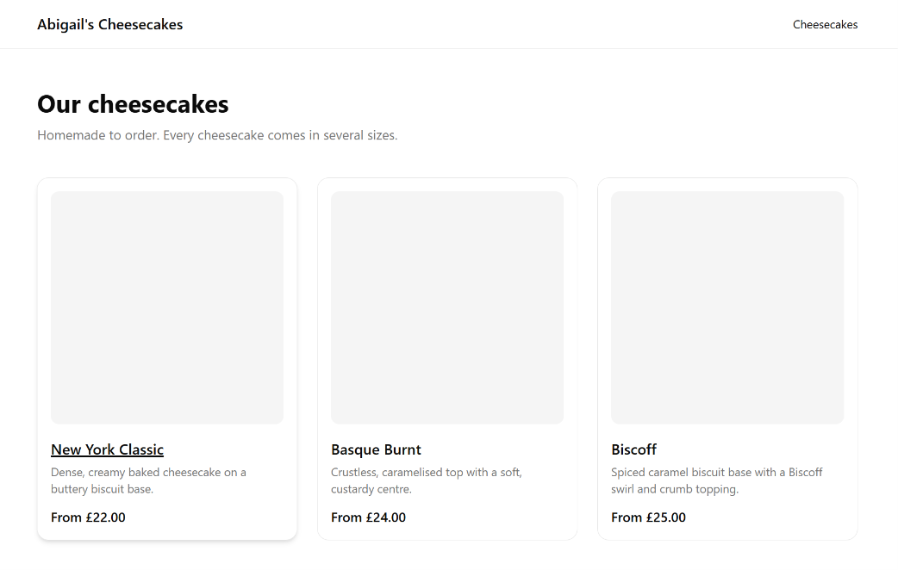

# Abigail's Cheesecakes

Full-stack ordering platform for a real homemade cheesecake business in London: a public storefront, an admin panel for the owner, and (in a later phase) a mobile app — built as a TypeScript monorepo on Next.js and Supabase.



## What works today

- **Live catalogue** at `/cheesecakes`, rendered by a React Server Component that reads products and sizes from Supabase Postgres. The page is statically generated and revalidated every 5 minutes (ISR).
- **Database layer** with versioned SQL migrations, Row Level Security on every table, and TypeScript types generated from the schema.
- **Order placement** through a single transactional Postgres function (`place_order`), ready for the checkout UI.
- **Shared packages** for data access, Zod validation and formatting, written to be reused unchanged by a future Expo mobile app.

## Key design decisions

- **Row Level Security is the security boundary.** The site only ever uses Supabase's publishable key. Visitors can read active products; every write except order placement is restricted to admins, enforced by Postgres policies rather than application code.
- **Orders go through a security-definer RPC, not direct inserts.** Anonymous users have no table write access. `place_order` validates items and delivery zones, reads prices from the database (so clients can't set their own), and writes the customer, order and line items in one transaction.
- **Money is stored as integer pence**, avoiding floating-point errors. Order lines snapshot the product name, size and price at order time, so order history stays accurate if prices change.
- **Measurements are stored metric and displayed imperial by default**, with conversion in a shared package.
- **Monorepo from day one.** Everything that isn't UI lives in `packages/`, so the planned mobile app can reuse the data layer without a refactor.

## Tech stack

| Layer      | Choice                                                           |
| ---------- | ---------------------------------------------------------------- |
| Frontend   | Next.js 16 (App Router, Server Components), React 19, TypeScript |
| Styling    | Tailwind CSS 4, shadcn/ui                                        |
| Backend    | Supabase — Postgres, Row Level Security, Storage, Auth           |
| Validation | Zod 4                                                            |
| Monorepo   | Turborepo, pnpm workspaces                                       |
| Tooling    | ESLint 9 (typescript-eslint strict), Prettier, Supabase CLI      |

## Repository structure

```
abigail-cheesecakes/
├── apps/
│   └── web/                # Next.js storefront (admin to follow)
├── packages/
│   ├── database/           # Typed Supabase client, generated types, query functions
│   ├── validation/         # Zod schemas shared by server and client
│   └── shared/             # Constants and formatting (prices, units)
└── supabase/
    ├── migrations/         # Schema, RLS policies, RPC, storage bucket
    ├── seed.sql            # Sample products and delivery zones
    └── README.md           # Schema and security model documentation
```

See [`supabase/README.md`](supabase/README.md) for the full schema and RLS policy documentation.

## Running locally

**Prerequisites:** Node.js 20+, pnpm 11+, and a Supabase project.

1. Install dependencies:
   ```bash
   pnpm install
   ```
2. Link the Supabase CLI to your project and apply the migrations and seed data:
   ```bash
   pnpm exec supabase login
   pnpm exec supabase link --project-ref <your-project-ref>
   pnpm exec supabase db push --remote --include-seed
   ```
3. Create `apps/web/.env.local` with your project's URL and **publishable** key:
   ```
   NEXT_PUBLIC_SUPABASE_URL=https://<your-project-ref>.supabase.co
   NEXT_PUBLIC_SUPABASE_PUBLISHABLE_KEY=<your-publishable-key>
   ```
4. Start the app at http://localhost:3000:
   ```bash
   pnpm dev
   ```

Other commands:

```bash
pnpm build                  # production build
pnpm typecheck              # strict TypeScript across all packages
pnpm lint                   # ESLint across all packages
pnpm --filter web db:check  # smoke test: fetch products as an anonymous visitor
```

## Roadmap

- [x] **Foundation** — monorepo, tooling, shared TypeScript config
- [x] **Database & domain layer** — schema, RLS, RPC, generated types, Zod schemas
- [ ] **Storefront** — catalogue ✅, product pages, basket, checkout with WhatsApp handoff
- [ ] **Admin panel** — Supabase Auth, product and order management, image upload
- [ ] **Production** — Vitest and Playwright tests, GitHub Actions CI, Vercel deployment
- [ ] **Mobile app** — Expo admin app with push notifications, reusing the shared packages

## Development approach

Work is planned in sequential blocks, each with a written Definition of Done that is verified before the next block starts. Commits follow [Conventional Commits](https://www.conventionalcommits.org/).
